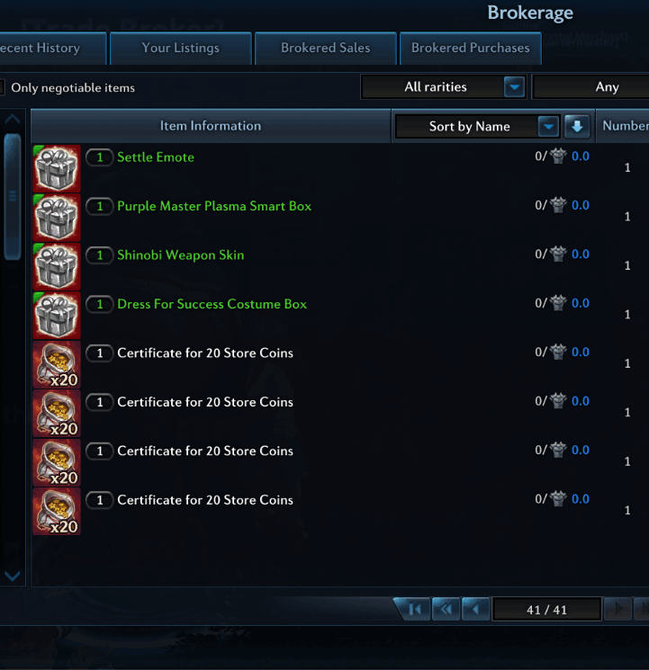
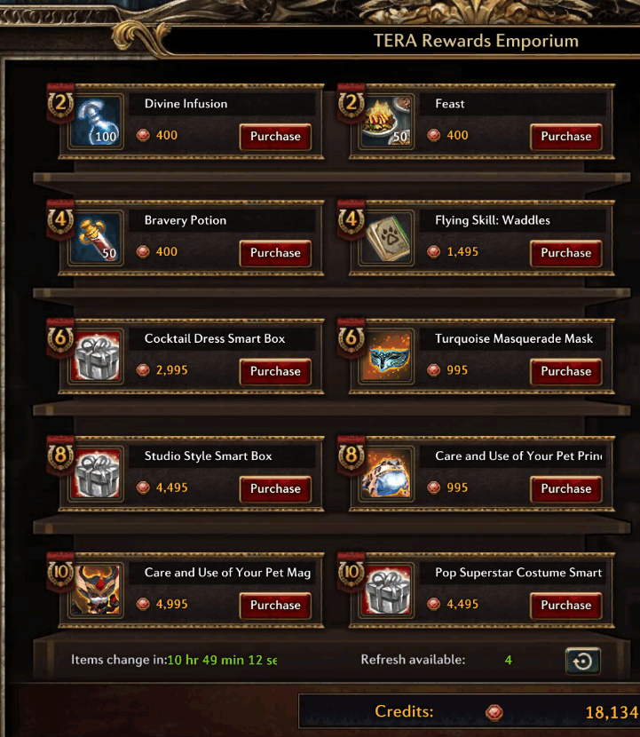

# Box Preview

**Prévia de caixas e aparências para TERA Toolbox, por emilia-s2.** Consulte os conteúdos declarados de caixas e experimente roupas, skins de armas e acessórios no provador do jogo, antes de comprar ou abrir o item.

Você pode consultar caixas e cosméticos no inventário, no broker, no TERA Rewards, em lojas ou em qualquer outra tela do TERA que mostre o ícone do item. Aponte para o ícone e use o atalho. Se o mod reconhecer o item, a prévia abre sem precisar possuí-lo ou saber seu ID. Para links no chat, abra primeiro o painel de detalhes do item no TERA.

## Atalhos e comandos

| Atalho ou comando | Função |
| --- | --- |
| **Shift + clique esquerdo** ou **botão do meio** | Consultar o item com o tooltip visível. O botão do meio funciona quando a opção da rodinha está ativa. |
| **Ctrl+Alt+B** ou `!boxpreview` | Abrir a janela completa. |
| `!boxpreview ID` | Consultar pelo ID do item. Exemplo: `!boxpreview 180910`. |
| `!boxpreview status` | Conferir o estado do mod e dos atalhos. |
| **Esc** ou **X** | Fechar a janela de consulta. |

## Demonstrações

### Caixas no broker

Consulte o conteúdo de uma caixa e alterne entre as variantes compatíveis com seu personagem e a lista completa.

  

### Cosméticos avulsos no TERA Rewards

Consulte também itens fora de caixas, como máscaras e outros acessórios, e use o olho para abrir a prévia nativa quando o item for compatível.

  

## Uso rápido

1. Abra Toolbox e TERA em **janela ou sem bordas** e entre com seu personagem.
2. Aponte o cursor para o ícone da caixa ou do cosmético. Aguarde o tooltip aparecer com o nome completo.
3. Use **Shift + clique esquerdo** no ícone. Se **Abrir com a rodinha (botão do meio)** estiver marcado, você também pode apertar o botão central.
4. Na janela do mod, clique no **olho** ao lado de um item compatível para experimentá-lo no personagem.

Para um link do chat, abra o painel de propriedades do item e use o atalho com o cursor sobre o ícone desse painel. A leitura dentro da descrição também pode funcionar, desde que o título esteja legível; o ícone é o ponto recomendado.

Os atalhos de consulta atuam com TERA em primeiro plano e o cursor sobre o jogo. Cada pressionamento consulta uma vez; segurar a tecla ou o botão não repete. Solte antes de consultar outro item. **Girar a rodinha não abre a prévia.** Ctrl sozinho e Alt + clique não são mais atalhos de consulta.

O botão central continua sendo recebido pelo jogo. Se houver outra ação configurada para ele no TERA, use Shift + clique esquerdo como alternativa. O clique esquerdo também continua sendo recebido pelo jogo.

## Caixas e cosméticos avulsos

**Caixas:** a janela mostra as variantes e filtra as compatíveis com a raça, o gênero e a classe do personagem conectado. Marque **Mostrar todas as variantes** para consultar as demais; isso não libera o provador para itens incompatíveis. As quantidades e condições mostradas são as declaradas na fonte consultada, não probabilidades de sorteio.

**Itens avulsos:** a janela mostra o próprio item, com o título **Prévia de aparência** e o olho quando ele é compatível. São reconhecidos roupas cosméticas, skins de armas, capas, acessórios de cabelo/rosto, roupas íntimas e pegadas com modelo visual disponível no cliente. Montarias, consumíveis e aparências de parceiros não são tratados como roupas do personagem.

Os ícones são carregados de um pacote local de imagens incluído no mod. Alguns cosméticos específicos podem ficar sem ícone se a imagem ainda não estiver nesse pacote; a identificação e o botão de experimentar não dependem da imagem.

Ao clicar no olho, as janelas do mod são ocultadas para deixar o personagem visível. Feche o provador pelos controles do próprio TERA. Para experimentar outro item, aponte para ele e use novamente Shift + clique esquerdo ou o botão central habilitado.

O provador usa a aparência padrão do item; tinturas personalizadas de uma unidade não são reproduzidas. Efeitos, como pegadas, dependem do suporte da prévia nativa. O mod não compra, abre, equipa ou consome itens. A prévia é enviada apenas ao cliente pelo pacote `S_PREVIEW_ITEM`.

A janela completa permite consultar IDs e listas opcionais de **Inventário**, **TERA Rewards** e **Outras lojas**. Essas listas dependem dos dados já recebidos pelo cliente e não precisam conter todos os itens disponíveis. Após recarregar o mod, reabra a loja se precisar receber sua lista novamente.

## Opção da rodinha

A opção **Abrir com Scroll (botão do meio)** fica no topo da janela pequena e também na janela completa. A escolha é salva em `config.json`, no campo booleano `data.openWithMiddleMouse`, e vale para novas consultas assim que a gravação é confirmada. O padrão é `true` (marcado) para instalações novas ou configurações sem essa preferência; desmarque se não quiser usar a rodinha além de Shift + clique esquerdo. Uma escolha `false` já salva continua respeitada. Ela é preservada após recarregar ou reiniciar o mod. Uma falha ao salvar é exibida na janela e não confirma uma preferência que não foi gravada.

## Idioma

O seletor fica na janela completa e oferece **Automático**, **Português**, **English** e **Español (Latinoamérica)**. A janela pequena segue a mesma preferência.

No modo automático, a interface segue o idioma do Windows; idiomas não suportados usam inglês. Uma escolha manual tem prioridade, atualiza as duas janelas e fica salva após recarregar o mod ou reiniciar Toolbox. Os nomes e as descrições dos itens continuam no idioma fornecido pelo cliente TERA.

As preferências são armazenadas localmente em `config.json`, com versão de configuração 2. Os valores de idioma são `auto`, `pt`, `en` e `es`. **Não publique nem copie esse arquivo sobre a configuração de outro usuário.** O mod cria os padrões no computador de cada pessoa.

## Identificação e origem dos conteúdos

O mod prioriza um ID recente recebido do jogo e associado à posição do cursor. Identificadores de unidades do inventário (`dbid`) são conferidos com as listas recebidas, preservando seus 64 bits; não são tratados como IDs de modelos de item.

Quando falta um ID seguro, o OCR do Windows lê o tooltip e compara seu título com os nomes do cliente conectado. A identificação também pode usar a posição na lista de Rewards, a qualidade reconhecida do título e as restrições completas de troca, venda e armazenamento, quando há evidência suficiente. Texto cortado ou metadados ausentes não autorizam uma escolha por tentativa.

Itens com o mesmo nome podem ter IDs ou conteúdos diferentes. O mod interrompe a consulta quando não consegue distingui-los com segurança. Se vários IDs de caixas declararem exatamente os mesmos conteúdos e condições, pode mostrar **IDs com conteúdo equivalente**, sem afirmar um ID exato que o jogo não forneceu.

As variantes vêm de `ItemConversion / SeedItem / FixedItem` do DataCenter conectado. No Asura, uma caixa conhecida pelo cliente que não declare sua conversão pode ser consultada no catálogo público `tera-asura.com/en/item/ID`. Essa origem aparece na janela, e os nomes são conferidos com o cliente. A consulta ao catálogo precisa de internet; quantidades e probabilidades ausentes são omitidas.

## Se uma consulta não funcionar

- **O item não foi reconhecido:** mantenha o tooltip inteiro visível, aguarde sua abertura e pressione o atalho novamente sem mover imediatamente o cursor. Em links do chat, abra primeiro o painel do item.
- **Há um aviso sobre nomes iguais ou ID inseguro:** tente pelo ícone no inventário ou na loja para que o jogo possa fornecer o ID. Se você já souber o ID correto, também pode consultá-lo na janela completa.
- **O olho não aparece:** confira a compatibilidade com o personagem. O item também pode não ter modelo visual ou suporte ao provador no protocolo conectado. Mostrar todas as variantes não altera essas condições.
- **Falta apenas o ícone:** a imagem pode estar ausente do pacote local. Isso não impede a consulta ou o provador quando o item é reconhecido e compatível.
- **A loja não aparece na lista após um reload:** feche e reabra a loja para receber seus dados novamente.
- **O atalho não responde:** verifique `!boxpreview status`, deixe TERA em primeiro plano e use o modo janela ou sem bordas. Para a consulta pela janela completa, use `!boxpreview`.

Nem toda caixa declara seu conteúdo no cliente ou no catálogo. Regras aleatórias, seletores e alterações exclusivas do servidor podem estar indisponíveis; ausência de dados não significa caixa vazia. O OCR precisa de um idioma de reconhecimento instalado no Windows e de texto legível. A janela externa não é compatível com tela cheia exclusiva.

## Diagnóstico e publicação

O mod não modifica os arquivos do jogo nem injeta DLL/GPK. As capturas usadas no reconhecimento ficam temporariamente na memória. O leitor é encerrado no lobby ou ao descarregar o mod.
